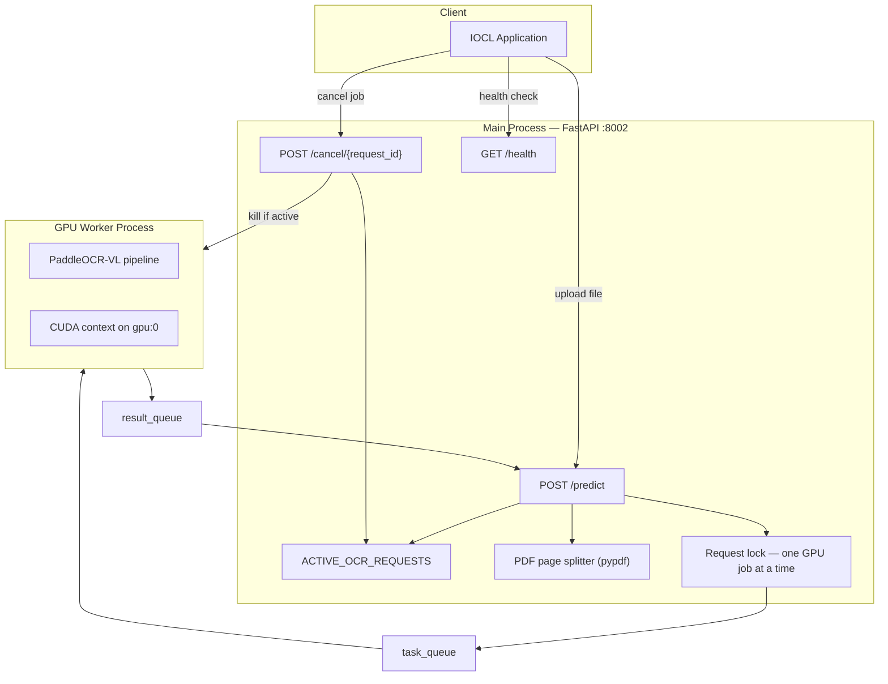
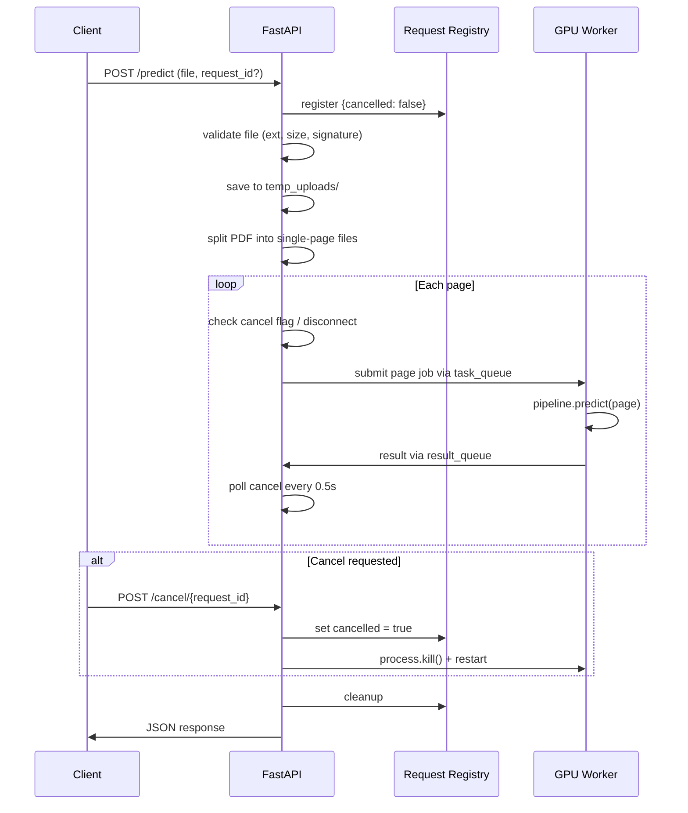

# In-Depth Project Analysis: IOCL OCR Service

## Executive Summary

The **IOCL OCR Service** is a GPU-backed document parsing microservice built for the Indian Oil Corporation Limited (IOCL) project. It exposes a REST API that accepts uploaded images or PDFs and returns structured OCR output using **PaddleOCR-VL** — a vision-language model specialized in document understanding.

The service runs on **FastAPI** (port `8002`), requires an **NVIDIA GPU**, and is designed around a key production concern: **cancellable GPU inference**. Long OCR jobs on shared GPU hardware can be stopped mid-run — either by client disconnect or an explicit cancel API — and GPU memory is freed immediately by killing the worker process.

The project lives in a single Python file (`ocr_service.py`, v2.1.0), ships with a CUDA-enabled Dockerfile, and has minimal dependencies. It is functional and production-minded in its GPU handling, but lacks documentation, tests, authentication, and configuration flexibility.

---

## Project Overview

| Attribute | Detail |
|-----------|--------|
| **Repository** | `websites-pro/ocr_service` (Bitbucket) |
| **Branch** | `dev` |
| **Version** | 2.1.0 |
| **Runtime** | Python 3, FastAPI + Uvicorn |
| **Port** | `8002` |
| **Compute** | NVIDIA GPU (`gpu:0`) |
| **Organization** | PrometheanTech |

### Purpose

Provide a standalone HTTP service that upstream IOCL applications can call to:

- Upload scanned documents, photos, or PDFs
- Extract text and document structure via AI-powered OCR
- Cancel in-progress OCR jobs without leaving GPU resources locked

### Project Structure

```
ocr_service/
├── ocr_service.py      # Application (API + GPU worker logic)
├── requirements.txt    # Python dependencies
├── Dockerfile          # CUDA 12.6 GPU container
├── .dockerignore
└── .gitignore
```

There is no README, no test suite, and no docker-compose file.

---

## Technology Stack

| Layer | Technology | Version |
|-------|-----------|---------|
| Web framework | FastAPI | 0.139.0 |
| ASGI server | Uvicorn | 0.35.0 |
| OCR engine | PaddleX `[ocr]` | 3.7.2 |
| Deep learning | PaddlePaddle GPU | 3.2.0 |
| PDF handling | pypdf | unpinned |
| CUDA runtime | nvidia/cuda + cuDNN | 12.6.3 |
| Base OS | Ubuntu | 22.04 |

### OCR Model: PaddleOCR-VL

The service uses the **PaddleOCR-VL** pipeline from PaddleX, which is a full document parsing system — not plain text OCR. It runs a multi-stage pipeline:

1. **Layout analysis** (`PP-DocLayoutV2`) — detects document regions (titles, paragraphs, tables, charts, formulas)
2. **Region cropping** — isolates each detected element
3. **VLM recognition** (`PaddleOCR-VL-0.9B`) — a 0.9B parameter vision-language model reads each block
4. **Result assembly** — structured JSON output per page

Capabilities include 109 languages, table/formula/chart recognition, and efficient GPU inference (~1.2 pages/sec on A100-class hardware).

---

## Architecture



### Two-Process Design

The service splits work across two OS processes:

**Main process** — runs FastAPI, handles HTTP, validates uploads, splits PDFs, manages cancellation state.

**GPU worker process** — spawned via `multiprocessing` with the `spawn` context (avoids inheriting CUDA state). Loads the PaddleOCR-VL model once and processes page-level jobs from a task queue.

Communication happens through two multiprocessing queues:
- `task_queue` — main → worker (request_id, file path)
- `result_queue` — worker → main (request_id, status, payload)

### Why a Separate GPU Process?

GPU inference cannot be safely interrupted from a thread. If a client disconnects while OCR is running inside the main process, the GPU keeps working and VRAM stays allocated.

The solution: run inference in an isolated process that can be **hard-killed** with `process.kill()`. This immediately tears down the CUDA context and frees GPU memory. A fresh worker is then spawned for the next request.

```863:871:d:\PrometheanTech\Projects\IOCL\ocr_service\ocr_service.py
    def kill_and_restart(self):
        if self.process is not None:
            logger.warning(f"Killing GPU worker PID={self.process.pid} to free GPU VRAM immediately.")
            self.process.kill()
            self.process.join(timeout=5)
        self.current_request_id = None
        self._drain(self.task_queue)
        self._drain(self.result_queue)
        self._start_worker()
```

---

## API Reference

### `GET /`

Redirects to Swagger UI at `/docs`.

### `GET /health`

Returns service and worker status.

**Response:**
```json
{
  "status": "healthy",
  "worker_alive": true,
  "worker_pid": 12345,
  "current_request_id": "abc123" 
}
```

`current_request_id` is `null` when the GPU is idle.

### `POST /predict`

Runs OCR on an uploaded file.

**Input:** `multipart/form-data`

| Field | Type | Required | Description |
|-------|------|----------|-------------|
| `file` | File | Yes | Image (`.png`, `.jpg`, `.jpeg`) or PDF |
| `request_id` | String | No | Client-supplied ID for cancellation tracking. Auto-generated if omitted. |

**Validation rules:**
- Allowed extensions: `.png`, `.jpg`, `.jpeg`, `.pdf`
- Max file size: 100 MB
- Magic-byte signature check (prevents extension spoofing)

**Success response (200):**
```json
{
  "ok": true,
  "status": "success",
  "message": "OCR prediction completed successfully",
  "data": {
    "filename": "invoice.pdf",
    "extractedContent": "Line 1\nLine 2\n...",
    "prediction_duration_seconds": 12.34,
    "results": [
      {
        "page_index": 0,
        "page_count": 3,
        "width": 2480,
        "height": 3508,
        "parsing_res_list": [
          {
            "block_label": "doc_title",
            "block_content": "Invoice",
            "block_bbox": [100, 50, 500, 120],
            "block_order": 0
          }
        ]
      }
    ]
  }
}
```

**Error responses:**

| Status | Condition |
|--------|-----------|
| 400 | Invalid extension, size, or file signature |
| 499 | Client cancelled or disconnected |
| 500 | Inference error |
| 503 | GPU worker unavailable |

### `POST /cancel/{request_id}`

Explicitly cancels an in-progress or pending OCR request.

**Response:**
```json
{
  "ok": true,
  "status": "cancelled",
  "message": "Cancellation requested for abc123",
  "gpu_worker_killed": true
}
```

If the request is actively running on the GPU worker, the worker process is killed immediately and restarted.

---

## Request Lifecycle



### Cancellation Mechanisms

The service supports three ways to stop a job:

1. **Explicit API call** — `POST /cancel/{request_id}` sets a flag and kills the worker if active
2. **TCP disconnect** — detected via `request.is_disconnected()`
3. **Async cancellation** — `asyncio.CancelledError` triggers worker kill

Cancellation is checked at four points:
- Before GPU execution begins
- Before each page is dispatched
- Every 0.5 seconds while waiting for GPU results
- On the `/cancel` endpoint (immediate kill if running)

### PDF Processing

Multi-page PDFs are split into individual single-page files before OCR:

```747:759:d:\PrometheanTech\Projects\IOCL\ocr_service\ocr_service.py
def split_pdf_pages(pdf_path: str, output_dir: str) -> list[str]:
    """Split a multi-page PDF into individual single-page PDF files."""
    reader = PdfReader(pdf_path)
    page_paths = []
    prefix = uuid.uuid4().hex
    for i, page in enumerate(reader.pages):
        writer = PdfWriter()
        writer.add_page(page)
        page_path = os.path.join(output_dir, f"{prefix}_page_{i}.pdf")
        with open(page_path, "wb") as f_out:
            writer.write(f_out)
        page_paths.append(page_path)
    return page_paths
```

Each page becomes a separate GPU job (`{request_id}_p0`, `{request_id}_p1`, …), enabling cancellation between pages rather than waiting for the entire document to finish.

### Content Extraction

The `clean_prediction_result` function produces two outputs:

- **`extractedContent`** — flat text built from selected block labels: `number`, `paragraph_title`, `vision_footnote`, `doc_title`, `text`
- **`results`** — full structured per-page data including all block types (tables, charts, formulas, images)

Tables and structured elements appear in `results` but are excluded from the flat `extractedContent` string. Consumers needing table data must parse `results[].parsing_res_list` directly.

---

## Deployment

### Docker

The Dockerfile builds a CUDA 12.6 runtime image:

- Installs Python 3, system libraries (`libgl1`, `libgomp1`)
- Installs `paddlepaddle-gpu==3.2.0` from PaddlePaddle's CUDA 12.6 repository
- Installs application dependencies from `requirements.txt`
- Runs as non-root user `appuser`
- Exposes port `8002`
- Starts with `python ocr_service.py`

**Requirements to run:**
- NVIDIA GPU with CUDA 12.6 support
- Docker with NVIDIA Container Toolkit (`--gpus all`)

**Example run:**
```bash
docker build -t ocr-service .
docker run --gpus all -p 8002:8002 ocr-service
```

### Gaps in Deployment Setup

- No `HEALTHCHECK` directive in Dockerfile
- Model weights are downloaded at first run (needs network access, slow cold start)
- No environment variable configuration (port, device, pipeline version all hardcoded)
- No docker-compose for local development

---

## Strengths

1. **True GPU cancellation** — Killing the worker process frees VRAM immediately; critical for shared GPU servers
2. **Explicit cancel API** — UI/backend can cancel without dropping the TCP connection
3. **Per-page PDF processing** — Fine-grained cancellation for multi-page documents
4. **Request tracing** — Every log line includes `request_id` for debugging
5. **Solid input validation** — Extension, size limit, and magic-byte checks
6. **Worker health visibility** — `/health` exposes PID and active request
7. **Clean temp file lifecycle** — UUID filenames with guaranteed cleanup in `finally`
8. **State-of-the-art OCR** — PaddleOCR-VL handles complex documents, 109 languages, tables, formulas

---

## Issues and Risks

### Critical

| Issue | Detail |
|-------|--------|
| **`request_id` not returned in response** | Server auto-generates one if the client omits it, but never echoes it back — the client cannot cancel unless it pre-generated the ID |
| **687 lines of commented dead code** | Old implementations (v1.0, v2.0) left in the file (lines 1–692). Makes the codebase hard to read, review, and maintain |
| **`pymupdf` unused** | Listed in `requirements.txt` but not imported anywhere — adds unnecessary install weight |
| **No authentication** | All endpoints are open; anyone can consume GPU resources or cancel other users' jobs |

### High

| Issue | Detail |
|-------|--------|
| **Model reload cost on cancel** | Every cancellation kills and restarts the worker, reloading the full model (seconds of downtime + VRAM spike) |
| **In-memory request registry** | `ACTIVE_OCR_REQUESTS` is lost on restart; no TTL for orphaned entries |
| **CORS misconfiguration** | `allow_origins=["*"]` with `allow_credentials=True` is invalid per browser spec |
| **Partial results not returned** | Cancel mid-PDF returns 499 with no OCR data from pages already processed |
| **`pypdf` unpinned** | No version constraint — builds may behave differently over time |

### Medium

| Issue | Detail |
|-------|--------|
| **No README or API docs** | No setup guide, integration examples, or cancel flow documentation |
| **No tests** | No unit or integration tests for validation, cancellation, PDF split, or worker restart |
| **503 window after kill** | Brief period after worker kill where new requests fail until model reloads |
| **Single serialized GPU access** | Second request blocks on `asyncio.Lock` with no queue visibility |
| **Hardcoded configuration** | GPU device, port, pipeline name, file size limit — all fixed in source |
| **Outdated pipeline version** | Uses base `PaddleOCR-VL`; newer `PaddleOCR-VL-1.6` offers 96.3% accuracy with seal/skew support |

### Low

| Issue | Detail |
|-------|--------|
| **HTTP 499 status** | Non-standard code (nginx convention); some proxies may not handle it |
| **Daemon worker process** | Worker marked `daemon=True` — abrupt parent exit may not clean GPU cleanly |
| **`temp_uploads/` not in `.gitignore`** | Runtime artifacts could be accidentally committed |
| **Full file read into memory** | 100 MB files loaded entirely before processing (no streaming) |

---

## Performance Characteristics

| Scenario | Expected Behavior |
|----------|-------------------|
| Single image | ~1–5 seconds depending on complexity |
| 50-page PDF | ~40+ seconds sequential (one page at a time) |
| Cancel mid-page | Worker killed instantly; next request waits for model reload (~5–30s) |
| Concurrent requests | Serialized — second request waits until first completes or is cancelled |
| Cold start | Model download + load on first worker spawn |

For high-volume IOCL workloads, consider an async job queue pattern where `/predict` returns a `request_id` immediately and results are fetched separately.

---

## Fit for IOCL Use Cases

| Use Case | Fit | Notes |
|----------|-----|-------|
| Scanned invoices / receipts | Good | Text extraction works well |
| Multi-page PDF forms | Good | Per-page processing with cancellation |
| Tables / structured data | Partial | Available in `results`, not in `extractedContent` |
| Handwritten documents | Moderate | VLM handles some handwriting; accuracy varies |
| Seals / stamps | Limited | Requires PaddleOCR-VL-1.5+ pipeline |
| Skewed / photographed docs | Limited | Needs document unwarping module |
| High-volume batch OCR | Needs work | Requires request queue and horizontal GPU scaling |

---

## Recommendations

### Immediate

1. Return `request_id` in every `/predict` response so clients can cancel
2. Remove commented dead code (lines 1–692) — git history preserves it
3. Remove unused `pymupdf` from requirements; pin `pypdf` version
4. Add `temp_uploads/` to `.gitignore`

### Before Production

5. Add authentication (API key or bearer token) on `/predict` and `/cancel`
6. Fix CORS — either specific origins or `allow_credentials=False`
7. Write a README with setup, API examples, and cancel flow
8. Add Docker `HEALTHCHECK` on `/health`
9. Externalize config via environment variables (`DEVICE`, `PORT`, `PIPELINE_NAME`, `MAX_FILE_SIZE_MB`)

### Future Enhancements

10. Upgrade to `PaddleOCR-VL-1.6` for better accuracy
11. Return partial results when cancelled mid-PDF
12. Add integration tests for the cancel workflow
13. Pre-bake model weights in the Docker image
14. Add Prometheus metrics (request count, latency, queue depth)

---

## Summary

The IOCL OCR Service is a focused GPU microservice that wraps PaddleOCR-VL behind a FastAPI REST API with a well-designed cancellation architecture. The separate GPU worker process with hard-kill on cancel is the right approach for shared GPU environments where abandoned jobs must not block the queue.

The service is ready for integration testing but needs cleanup (dead code, unused dependencies), documentation, authentication, and the `request_id` response fix before production deployment. The core v2.1.0 design — multiprocessing worker, per-page PDF jobs, explicit cancel API — is solid and appropriate for IOCL document processing workloads.