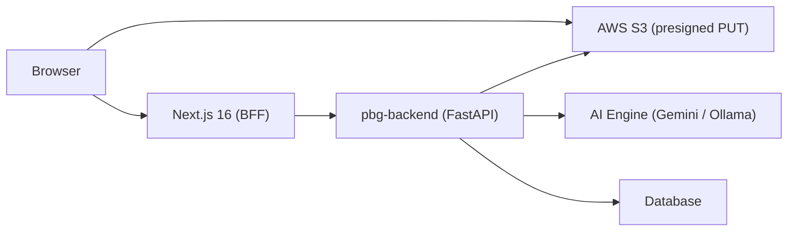

# PBG Comparison System — Detailed Project Analysis

This is a **Next.js 16 frontend/BFF** for IOCL’s Performance Bank Guarantee (PBG) verification workflow. The codebase has **outgrown its documentation**: it is no longer a client-only Gemini app, but a **multi-service enterprise application** with auth, S3 storage, async AI jobs, and a separate Python backend.

---

## 1. Executive Summary

| Dimension | Assessment |
|-----------|------------|
| **Purpose** | Upload master PBG templates, compare vendor BG PDFs via AI, detect clause deviations, generate IOCL amendment letters |
| **Maturity** | Functional product UI with admin tooling; documentation and some config are stale |
| **Architecture** | Solid BFF pattern; backend owns business logic |
| **Risk areas** | Doc drift, build error suppression, JWT in SSE query string, inconsistent routes, unused deps |
| **Deployment model** | Online (backend + S3 + AI); offline migration blueprint exists separately |

---

## 2. Current Architecture

The system follows a **Backend-for-Frontend (BFF)** pattern. The browser talks only to Next.js; Next.js proxies to `pbg-backend` (default `http://localhost:8001`).



### Core flow

1. **Master setup** — Admin uploads master PBG PDF → presigned S3 URL → backend extracts text → stored as active master format.
2. **Vendor upload** — User uploads up to 10 PDFs (15 MB each) → S3 direct upload → confirm → backend queues AI job.
3. **Processing** — Frontend polls `/api/process` every 8s; optional live AI token stream via SSE.
4. **Results** — Deviations (CRITICAL / MAJOR / MINOR), vendor metadata, amendment letter export (DOC via `html-docx-js`).
5. **History** — Server-backed comparison history with search, filters, stats, and detail view.

The proxy layer is clean and minimal:

```1:51:lib/backend-proxy.ts
/**
 * Server-side helper for proxying requests to the pbg-backend.
 * Uses BACKEND_API_URL (server-only, never exposed to the browser).
 */
// ...
export async function backendFetch(opts: ProxyOptions): Promise<NextResponse> {
  const url = `${BACKEND_URL}${path}`;
  // ...
}
```

All 25 API routes under `app/api/` are thin proxies — no business logic in the frontend server.

---

## 3. Technology Stack

| Layer | Technology |
|-------|------------|
| Framework | Next.js 16.2.6 (App Router, React Compiler, typed routes) |
| UI | React 19, shadcn/ui, Tailwind CSS 4, Lucide icons |
| Auth | JWT (access + refresh), localStorage session, silent refresh |
| Storage | AWS S3 (presigned URLs) |
| Export | `html-docx-js` for amendment letters |
| Virtualization | `@tanstack/react-virtual` (audit logs page) |
| Backend | External FastAPI service (not in this repo) |

**Notable versions:** React 19, Next 16 — modern stack.

---

## 4. Application Structure

### Routes (10 pages)

| Route | Purpose |
|-------|---------|
| `/` | Dashboard — master status, navigation |
| `/auth/login` | Login |
| `/compare` | Upload + active processing dashboard (~919 lines) |
| `/history` | Completed comparisons, filters, stats (~997 lines) |
| `/admin/compare-master` | Master PBG upload/preview |
| `/admin/users` | User CRUD, roles, password reset (~1141 lines) |
| `/admin/audit-logs` | Virtualized audit log viewer |
| `/admin/s3-test` | S3 integration testing |
| `/test-cancel` | Dev/test page for job cancellation |

### API surface (25 endpoints)

Grouped by domain:

- **Auth:** login, logout, refresh  
- **Documents:** upload-url, confirm, status, delete, comparison  
- **Jobs:** retry, stream-log (SSE passthrough)  
- **Master formats:** active, upload-url, confirm  
- **Users:** CRUD, status, reset-password  
- **Audit logs, history, comparisons, process, config**

---

## 5. Feature Analysis

### 5.1 Authentication & Authorization

**Strengths:**
- `AuthGuard` wraps the app with loading state, route protection, and 60s silent refresh
- Typed session in `lib/auth-storage.ts` with JWT expiry check (5 min buffer)
- Token refresh on mount and interval

**Gaps:**
- **Role enforcement is partial.** Admin pages check `admin | superadmin`; compare/history appear open to all authenticated users.
- **Route inconsistency:** Some pages redirect to `/login`, others to `/auth/login`. There is no `/login` page — only `/auth/login`. This is a bug in `compare-master`, `compare`, and `history`.

```306:310:app/compare/page.tsx
    const session = getSession();
    if (!session) {
      router.push("/login" as any);
      return;
    }
```

- JWT passed in SSE URL query string (`?token=...`) — visible in server logs, browser history, and referrer headers.

### 5.2 Upload & Processing

**Well implemented:**
- Presigned S3 upload (avoids sending large PDFs through Next.js)
- Multi-file batch (max 10)
- Per-file progress tracking
- Confirm-then-process pattern
- Polling for job status
- Live AI token stream panel (developer/operator visibility)

**Limits:**
- PDF only, 15 MB max
- 8s polling interval (reasonable; could use WebSocket/SSE for status too)

### 5.3 Comparison Results & Amendment Letters

`ComparisonDetailView` is the core results component:
- Severity badges (CRITICAL / MAJOR / MINOR)
- Tabbed UI: deviations, amendment letter preview, debug info
- DOC export via dynamic import of `html-docx-js`
- Hardcoded SFMS fields (7034–7037) for IOCL beneficiary details
- Bank branch address parsed from vendor metadata

Comparison logic (dynamic fields, severity rules, “In consideration” normalization) is documented in `docs/comparison-logic.md` but **implemented in the backend**, not this repo.

### 5.4 Admin & Audit

- Full user management (create, edit role, activate/deactivate, reset password)
- Roles: `superadmin`, `admin`, `reviewer`, `viewer`
- Audit logs with virtualized rendering for performance
- S3 test utilities for ops debugging

### 5.5 History

Server-backed history (not local IndexedDB as older docs describe):
- Date range filters (7d / 30d / all)
- Status filters (passed / deviations / failed)
- Search by vendor, BG number, PO
- Stat cards and detail drill-down
- Reuses `ComparisonDetailView`

---

## 6. Documentation Drift (Critical)

Several docs describe an **older architecture** that no longer exists in this repo:

| Document | Claims | Reality |
|----------|--------|---------|
| `AGENTS.md` | `simple-compare`, `gemini.ts`, localStorage master | Removed; backend + S3 |
| `README.md` | Default create-next-app boilerplate | Not project-specific |
| `docs/comparison-logic.md` | `/api/simple-compare`, localStorage | Backend handles comparison |
| `docs/history-requirements.md` | IndexedDB via localforage | Server `/api/history` |
| `BANK_ADDRESS_EXTRACTION.md`, `SEMANTIC_EQUIVALENCE_FIX.md` | Reference `lib/gemini.ts` | File does not exist |

**Impact:** New developers will follow wrong setup paths and look for files that were removed during migration.

---

## 7. Dependency Analysis

### Actively used
- `@aws-sdk/client-s3`, `@aws-sdk/s3-request-presigner` — via backend proxy (S3 test routes)
- `html-docx-js` — amendment letter export
- `@tanstack/react-virtual` — audit logs
- shadcn, lucide, tailwind — UI

### Appears unused in source (dead weight)
| Package | Notes |
|---------|-------|
| `@google/generative-ai` | No imports — AI moved to backend |
| `localforage` | No imports — history is server-side |
| `zustand` | No imports — state is local React state |
| `pdf-to-img`, `pdfjs-dist` | No imports — PDF handled by backend |

These add bundle/install size and suggest an incomplete cleanup after the backend migration.

---

## 8. Configuration & Build

### Environment variables (inferred)

| Variable | Purpose |
|----------|---------|
| `BACKEND_API_URL` | Python backend URL (server-only) |
| `USE_OLLAMA`, `OLLAMA_API_URL`, `OLLAMA_MODEL` | Exposed via `/api/config` for offline mode |
| AWS credentials | Likely backend-side; frontend uses presigned URLs |

**Missing:** No `.env.example` in the repo — onboarding friction.

### Build config concerns

```3:7:next.config.ts
const nextConfig: NextConfig = {
  // Disable TypeScript errors during build for demo
  typescript: {
    ignoreBuildErrors: true,
  },
```

This hides type errors and allows broken code to ship. Combined with `as any` casts on routes (`/login`, `/admin/audit-logs`), type safety is weakened.

### Dev environment
- pnpm requires Node ≥22.13; current shell has Node 18.20.6 — lint/build may fail locally without version upgrade.

---

## 9. Design System

`public/docs/DESIGN.md` documents a **Cohere-inspired** design system (CohereText, Unica77, deep green bands, coral chips).

**Actual UI:** Slate/orange IOCL branding, Inter font, standard shadcn cards — **does not follow DESIGN.md**.

This is not necessarily wrong for an IOCL internal tool, but the design doc is misleading if treated as the source of truth.

---

## 10. Code Quality Observations

### Strengths
- Consistent BFF proxy pattern
- Typed auth and user clients
- Separation of concerns (UI vs backend)
- Good UX touches: drag-drop upload, progress states, stream panel, virtualized logs
- Amendment letter generation is self-contained and exportable

### Weaknesses
- **Very large page components** (900–1100+ lines) — hard to test and maintain
- **Duplicated logic** — master format loading, session checks, headers repeated across pages
- **No shared layout** for authenticated pages (each page reimplements header/footer)
- **`useAutoRefresh` exists but is unused** — `AuthGuard` already handles refresh (redundant utility)
- **Test/dev pages in production tree** (`test-cancel`, `s3-test`) without route guards
- **No tests** visible in the repo
- **No error boundary** or global error handling strategy

---

## 11. Security Review

| Item | Severity | Detail |
|------|----------|--------|
| JWT in SSE query string | Medium | Token leakage via logs/Referer |
| Tokens in localStorage | Medium | XSS could steal session (common SPA tradeoff) |
| No CSRF on API routes | Low | JWT in Authorization header mitigates somewhat |
| Role checks frontend-only | Medium | Backend must enforce; frontend is UX only |
| S3 presigned URLs | Good | Direct upload, time-limited |
| Backend URL hidden | Good | BFF pattern prevents exposure |
| `ignoreBuildErrors` | Medium | Can ship runtime bugs |

---

## 12. Offline Migration Readiness

`pbg_offline_migration.md` is a thorough blueprint for moving from Gemini cloud to local Ollama + PaddleOCR. The frontend already exposes Ollama config via `/api/config`. The **backend** would need to implement the switch; this repo is mostly ready as a client.

---

## 13. Gap Analysis vs. Stated Goals (AGENTS.md)

| Feature | Status |
|---------|--------|
| Master PBG upload | ✅ Backend + S3 |
| Vendor PBG comparison | ✅ Async jobs |
| AI deviation detection | ✅ Backend (not in this repo) |
| Amendment letter generation | ✅ HTML + DOC export |
| Admin-configurable master | ✅ `/admin/compare-master` |
| No database (localStorage) | ❌ **Outdated** — now uses backend DB |
| Gemini in frontend | ❌ **Removed** — backend handles AI |

---

## 14. Recommended Priorities

### High priority
1. **Update documentation** — Rewrite `AGENTS.md`, `README.md`, and `docs/*` to reflect backend architecture.
2. **Fix auth route bugs** — Replace `/login` redirects with `/auth/login` everywhere.
3. **Remove `ignoreBuildErrors: true`** — Fix TypeScript issues properly.
4. **Add `.env.example`** — Document `BACKEND_API_URL` and related vars.
5. **Secure SSE auth** — Use cookie-based session or short-lived stream tokens instead of JWT in query string.

### Medium priority
6. **Remove unused dependencies** — `@google/generative-ai`, `localforage`, `zustand`, `pdf-to-img`, `pdfjs-dist`.
7. **Extract shared layout** — Authenticated shell (header, nav, logout).
8. **Split large pages** — Compare, history, users into hooks + subcomponents.
9. **Role-based route guards** — Restrict admin routes and optionally compare/history by role.
10. **Gate or remove dev pages** — `test-cancel`, `s3-test` behind admin or env flag.

### Lower priority
11. **Align or retire DESIGN.md** — Either adopt Cohere tokens or document IOCL theme.
12. **Add tests** — Auth flow, upload flow, proxy routes.
13. **Consolidate refresh logic** — Remove unused `useAutoRefresh` or use it consistently.

---

## 15. Overall Verdict

The project is a **capable enterprise frontend** for a specialized legal-document comparison workflow. The **core architecture (BFF + S3 + async jobs + auth)** is sound and appropriate for IOCL’s needs.

The main problems are **organizational, not functional**:
- Documentation describes a previous generation of the app
- Build/type safety is deliberately relaxed
- Some routing and security edges need tightening
- Page components have grown too large for long-term maintenance

**Backend dependency:** This repo cannot run standalone. It requires `pbg-backend` at `BACKEND_API_URL`, plus S3 and AI services configured on that backend. A full system review would need the backend repository as well.

